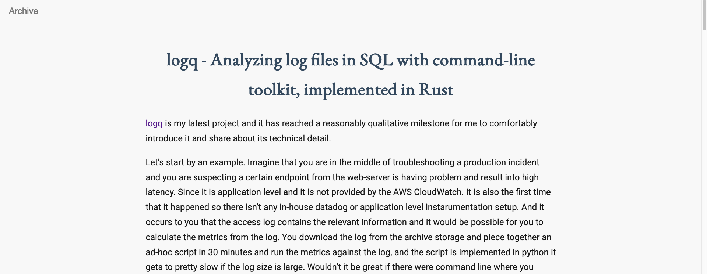

# Haspot

A static blog generator built on [Hakyll](https://jaspervdj.be/hakyll/), with a
clean, readable theme tuned for mixed English / Traditional Chinese / Japanese
text. It powers [blog.paulme.ng](https://blog.paulme.ng).



## Features

- Markdown posts rendered by Pandoc, with TeX math (`$..$`, `$$..$$`,
  `\(..\)`, `\[..\]`) rendered by MathJax 3. MathJax is only loaded on pages
  that actually contain math.
- Paginated front page (`/`, `/2/`, `/3/`, ...), an archive page, an Atom
  feed at `/rss/feed.xml`, a `sitemap.xml` and a `robots.txt`.
- Per-page `<title>`, canonical URL and Open Graph tags; optional Google
  Analytics and Search Console tags driven by configuration.
- A helper script for creating posts, previewing, deploying to GitHub Pages
  and building a Docker image.

## Prerequisites

- [Stack](https://docs.haskellstack.org/) (`brew install haskell-stack` on
  macOS). Stack downloads the pinned GHC for you.
- `pkg-config`, which some dependencies need at configure time
  (`brew install pkgconf` on macOS, `apt install pkg-config` on Debian/Ubuntu).

The first build compiles Pandoc and Hakyll from source and takes a while
(20-40 minutes on a recent laptop). Later builds are incremental.

## Quick start

```bash
git clone https://github.com/MnO2/haspot.git
cd haspot
stack build                    # compile the generator
stack run -- watch             # build the site and serve it on http://127.0.0.1:8000
```

`stack run -- <cmd>` forwards Hakyll's usual commands:

| Command                     | What it does                                              |
| --------------------------- | --------------------------------------------------------- |
| `stack run -- build`        | Generate the site into `_site/`                           |
| `stack run -- watch`        | Build, serve locally and rebuild on change                |
| `stack run -- rebuild`      | Clear the cache and build from scratch                    |
| `stack run -- clean`        | Remove `_site/` and `_cache/`                             |
| `stack run -- deploy`       | Run `./cmd_haspot.sh deploy` (see below)                  |
| `stack run -- check`        | Check the generated site for broken internal links        |

The same commands are wrapped by `./cmd_haspot.sh build` and
`./cmd_haspot.sh watch`.

## Writing a post

```bash
./cmd_haspot.sh new "My post title"
```

creates `posts/YYYY-MM-DD-my-post-title.md` with this front matter:

```yaml
---
title: "My post title"
date: 2026-09-06T14:03:21-0400
---
```

Notes:

- Posts live in `posts/` and the file name must start with `YYYY-MM-DD-`; the
  date in the file name is the fallback when the `date` field cannot be
  parsed. Hakyll understands `2026-09-06`, `2026-09-06 14:03:21` and
  `2026-09-06T14:03:21-0400`, among others.
- Add `lang: zh-Hant` (or `ja`, ...) to the front matter to set the `<html
  lang>` attribute of that post. The default is `en`.
- Images go under `images/` and are copied verbatim; reference them as
  `/images/...`. Hakyll rewrites absolute links to relative ones at build
  time.
- The front page shows two full posts per page. Change `postsPerPage` in
  `haspot.hs` to alter that.

## Configuration

All site-wide settings live in `conf/setting.yml`:

```yaml
author:
    name: Paul Meng                        # feed author and footer
    email: me@paulme.ng                    # feed author email
    intro: One-line bio (available to templates as $author_intro$)
blog:
    root_url: https://blog.paulme.ng       # no trailing slash; used for canonical URLs, feed and sitemap
    title: "Paul Meng's Blog"
    description: ""                        # <meta name="description"> and feed description (optional)
    about_page_link: /about                # target of the "About" nav item (root-relative)
    google_analytics_id: G-XXXXXXXXXX      # optional; omit to disable the gtag snippet
    google_site_verification: token        # optional; omit to drop the meta tag
```

Missing or empty optional keys simply drop the corresponding markup. Note that
Universal Analytics (`UA-...`) properties stopped collecting data in 2023; use
a GA4 measurement id (`G-...`) if you want analytics.

## Project layout

```
haspot.hs            the generator: rules, contexts and Pandoc options
haspot.cabal         package description (built with `stack`)
stack.yaml           pins the Stackage LTS snapshot (GHC + library versions)
conf/setting.yml     site settings (see above)
posts/               Markdown posts, one file each
templates/           Hakyll templates
  head.html            <head> shared by every page
  nav.html             top navigation
  footer.html          site footer
  index.html           paginated front page
  post.html            a single post
  teaser.html          a post as shown on the front page
  archive.html         list of all posts
  sitemap.xml, robots.txt
stylesheets/         customize.css, minified at build time
images/, favicon.ico copied as-is
about/               a static "About" page copied as-is
cmd_haspot.sh        helper script (new / build / watch / deploy / docker)
Dockerfile, default.conf   nginx image serving _site/
```

Generated output goes to `_site/`; Hakyll's cache lives in `_cache/`. Both are
ignored by git.

### Template variables

Besides Hakyll's defaults (`$body$`, `$url$`, `$title$`, front-matter keys),
every template can use:

| Variable                     | Value                                                         |
| ---------------------------- | ------------------------------------------------------------- |
| `$blog_title$`               | `blog.title`                                                  |
| `$blog_description$`         | `blog.description` (absent when empty)                        |
| `$root_url$`                 | `blog.root_url`                                               |
| `$about_page_link$`          | `blog.about_page_link`                                        |
| `$blog_google_analytics_id$` | `blog.google_analytics_id` (absent when unset)                |
| `$google_site_verification$` | `blog.google_site_verification` (absent when unset)           |
| `$author_name$`, `$author_intro$` | from the `author` section                               |
| `$current_year$`             | year at build time, for the copyright line                    |
| `$canonical_url$`            | absolute URL of the page, `index.html` stripped               |
| `$page_title$`               | the post's title, or `Archive`; absent on index pages         |
| `$og_type$`                  | `article` on posts, otherwise absent (template falls back to `website`) |
| `$mathjax$`                  | present when the page contains math                           |
| `$date$`, `$isodate$`        | `September 6, 2026` and `2026-09-06`, on posts                |

Index pages also get Hakyll's pagination fields (`$previousPageUrl$`,
`$nextPageUrl$`, `$currentPageNum$`, `$numPages$`, ...).

## Deploying

### GitHub Pages

`./cmd_haspot.sh deploy` rebuilds the site, copies `_site/` into a sibling
checkout of the GitHub Pages repository (`../mno2.github.io` by default, or
`$HASPOT_DEPLOY_DIR`), renames `customize.css` to a timestamped file so
browsers pick up style changes, commits and pushes. `stack run -- deploy` does
the same.

### Docker

```bash
stack run -- build
./cmd_haspot.sh docker         # builds and pushes paulmeng/blog:<version>
# or, for a local image only:
docker build -t haspot .
docker run --rm -p 8080:80 haspot
```

The image is plain nginx serving `_site/`; `default.conf` holds the server
configuration, including a couple of legacy domain redirects you will want to
edit or remove. Set `HASPOT_DOCKER_IMAGE` to push under a different name.

## Customising the theme

- `stylesheets/customize.css` holds all styling; PureCSS provides only the
  base reset and the menu classes.
- `about/` is a self-contained static page with its own copy of the
  stylesheet, so it can be redesigned independently of the blog templates.
- Fonts are loaded from Google Fonts (Noto Serif TC / Noto Sans TC / Noto Sans
  JP) in `templates/head.html`.

## Upgrading dependencies

`stack.yaml` pins a Stackage LTS snapshot; bump `resolver:` to a newer LTS that
contains `hakyll` (check <https://www.stackage.org/package/hakyll>), run
`stack build`, and commit the regenerated `stack.yaml.lock`.

## License

MIT, see [LICENSE](LICENSE). Blog content under `posts/` is the author's and
is licensed CC BY-NC-SA.
